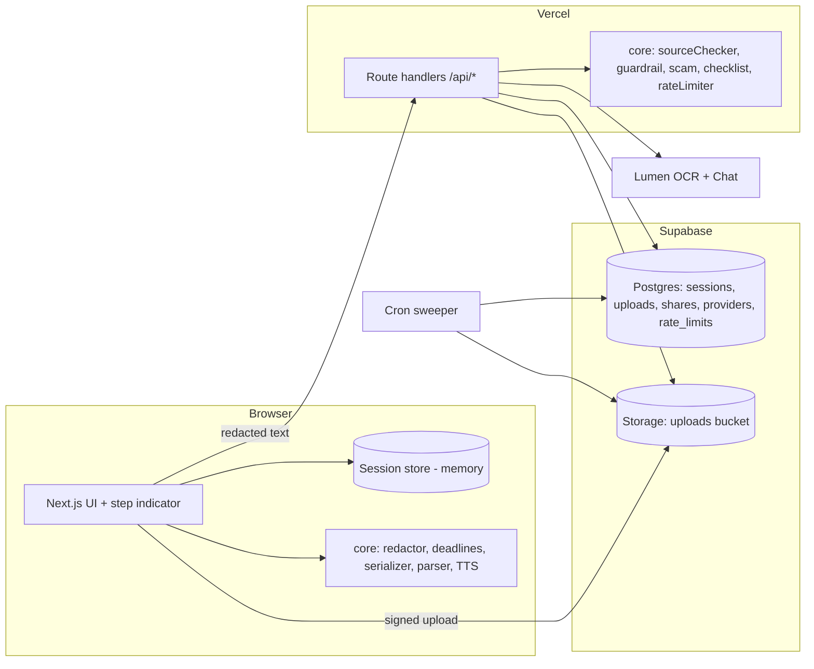
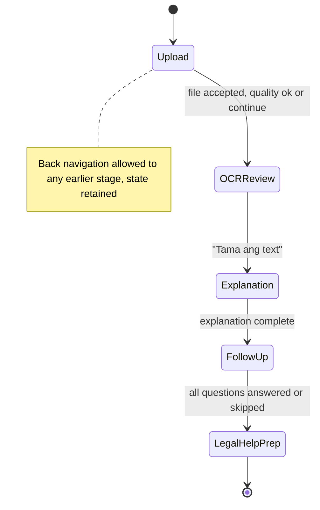

# Design Document: LegaLinaw

## Overview

LegaLinaw is a login-free Next.js (App Router, TypeScript) web app deployed on Vercel. A user uploads a photo or PDF of a legal notice. Lumen OCR extracts text, the user reviews it, and Lumen AI Chat produces a source-backed plain-language explanation in Filipino or English. The app never gives legal advice and routes users to free legal help.

### Working decisions

Assumptions A1 to A6 from the requirements are treated as decided. Where acceptance criteria are stricter, the criteria win.

| Item | Decision |
|---|---|
| A1 Share | Read-only page with redacted summary only. Row has `expires_at = created_at + 24h`. Deleted by expiry job, "Stop sharing", or "Delete my data" within 60 s (Req 20.7, 20.8). |
| A2 Retention | Files and extracted text deleted at session end and at most 24 h after upload. Deletion must finish within 60 s of the trigger (Req 5.9, 5.11, 5.12), so deletion is a direct call, backed by a sweeper job. |
| A3 Help data | Curated `providers` table in Supabase with `last_verified` per row. No live third-party fetch. |
| A4 Location | Province plus city/municipality selection. Browser geolocation is an optional shortcut. |
| A5 TTS | Browser Web Speech API (`speechSynthesis`). |
| A6 Redaction | Runs in the browser. Only redacted text leaves the browser. |

### Key design decisions

1. **Thin server, logic in pure modules.** Most behavior (redaction, deadlines, guardrail, source checking, scam scoring, serialization, checklist filtering, report fitting) lives in pure TypeScript modules under `src/core/`. They have no I/O, are shared by browser and server, and are the target of property tests.
2. **Lumen is called only from server route handlers.** Credentials are server env vars (Req 24.7). The browser calls `/api/*` routes, which enforce rate limits and timeouts.
3. **LLM output is untrusted.** Every Lumen response is parsed against a Zod schema. Then deterministic post-processors run: source validation (exact substring), guardrail, scam-level computation, checklist filtering. The model proposes, the code decides.
4. **Session without login.** An anonymous session id (random 128-bit, in an `HttpOnly; Secure; SameSite=Strict` cookie) keys server-side rows and rate limits. Working state (reviewed text, edits, checklist state, chat answers) lives in a client store (Zustand) held in memory. It is not persisted to `localStorage`, so closing the tab loses it, as the product states.
5. **Privacy placeholders.** The Redactor swaps values for tokens like `[PANGALAN_1]` in the browser. The token-to-value map stays in client memory only. Responses are rehydrated on screen only (Req 5.6).

### Research summary

- **Lumen**: the requirements name Lumen as the OCR and chat provider but do not specify its API. This design wraps it behind a `LumenClient` interface (`ocr`, `chat`) so the real SDK or HTTP shape can be bound later. See Open Decisions.
- **Next.js on Vercel**: route handlers run as serverless functions. Vercel redirects HTTP to HTTPS by default, and HSTS is added in `next.config.ts` headers (Req 24.5, 24.6). Request bodies on Vercel functions are limited to about 4.5 MB, so the 10 MB upload goes directly to Supabase Storage through a signed upload URL, not through a route handler. ([Vercel limits](https://vercel.com/docs/functions/limitations))
- **Supabase**: Storage signed upload URLs and Row Level Security. The app uses the service-role key server-side only. `pg_cron` or Vercel Cron drives the 24 h sweeper. ([Supabase Storage](https://supabase.com/docs/guides/storage))
- **Web Speech API**: `speechSynthesis.getVoices()` for `fil-PH`/`en-*` voice detection, `SpeechSynthesisUtterance.rate` for speed. Changing rate mid-utterance does not take effect in most browsers, so the player re-queues from the current character boundary. ([MDN SpeechSynthesis](https://developer.mozilla.org/en-US/docs/Web/API/SpeechSynthesis))
- **Property testing**: `fast-check` with Vitest. PDF generation: `pdf-lib` (runs on server and client, supports fixed page counts and embedded Unicode fonts such as Noto Sans for "ñ"). File-type sniffing from magic bytes: `file-type`. PDF page count: `pdf-lib` or `pdfjs-dist`. HEIC preview: `heic2any` in the browser.

Content from the linked docs was paraphrased for compliance with licensing restrictions.

## Architecture



### Stage flow



The five stages are upload, OCR and review, explanation, Lumen follow-up questions, and legal help preparation. `canEnter(stage, state)` is a pure function: a stage is available only if the previous stage is complete (Req 23.2).

### Confirmation fan-out

On "Tama ang text" the client runs the Redactor, then calls in parallel: `/api/classify`, `/api/explain`, `/api/scam`. The deadline tracker runs partly in the browser (date parsing on reviewed text) so the countdown works without Lumen. Each section renders independently with its own error and retry state (Req 23.3, 23.4). `/api/classify` runs first when the type is needed for `explain`; the client passes the type to the other calls once known.

### Rate limiting

Every Lumen-calling route calls `rateLimiter.check(sessionId, now)` first: sliding window of 10 minutes, maximum 20 requests. The 21st returns `{allowed:false, retryAfterSeconds}` (Req 24.8). State is a row per session in `rate_limits` holding request timestamps, so it holds across serverless instances.

## Components and Interfaces

### Pure core modules (`src/core/`)

| Module | Signature (abridged) | Requirements |
|---|---|---|
| `fileValidator` | `validateFile(bytes: Uint8Array, size: number, name: string): {ok:true,kind:'jpeg'\|'png'\|'heic'\|'pdf'} \| {ok:false,reason:'unsupported'\|'too_large'\|'too_many_pages'\|'unreadable'}` | 1.1, 1.2, 1.4, 1.5, 1.7, 1.8 |
| `uploadSlot` | `applyNewFile(current: Accepted\|null, result): Accepted\|null` (replace only on accept) | 1.9 |
| `qualityTips` | `tipsFor(flags: QualityFlags, lang): Tip[]` and `qualityFlow(flags\|error)` | 2.3 to 2.11 |
| `redactor` | `redact(text, detections, unmasked: Set<id>): {redacted, map}`; `rehydrate(text, map)` | 5.2, 5.5, 5.6, 4.8 |
| `entityDetector` | `detectEntities(text): Entity[]` (names, addresses, PH government IDs: SSS, TIN, PhilSys, UMID, passport, driver's license patterns) | 5.2 |
| `reviewGate` | `canConfirm(text): {ok:boolean, reason?:'empty'\|'too_long'}` | 4.6, 4.9 |
| `keyFields` | `needsVerification(field): boolean` (confidence below 80 and not edited) | 4.3, 4.4, 9.4, 9.5 |
| `confidence` | `levelOf(score\|undefined): 'High'\|'Medium'\|'Low'` | 9.1, 9.2, 9.6 |
| `sourceChecker` | `validateClaims(claims, reviewedText): Claim[]`, `markOutdated(refs, newText)` | 8.1 to 8.7, 11.4, 13.2 |
| `deadlines` | `extractDeadlines(candidates, now): DeadlineView[]`, `countdown(deadline, now)`, `urgency(...)`, `isAmbiguous(...)` | 10.1 to 10.10 |
| `scam` | `riskLevel(indicators: Indicator[]): 'Low'\|'Medium'\|'High'` | 11.3 |
| `guardrail` | `evaluate(text, lang): {ok:true}\|{ok:false, rule:'outcome'\|'directive'}` | 15.1, 15.2, 15.7 to 15.9 |
| `checklist` | `buildChecklist(raw, ctx)`: filters forbidden directives, clamps group sizes, puts provider item first when a deadline exists | 16.1 to 16.6 |
| `questions` | `addQuestion`, `editQuestion`, `removeQuestion`, `validateGenerated(list, ctx)` | 18.1 to 18.8, 18.10 |
| `classifier` | `resolveType(modelType, score, userOverride)` | 6.4, 6.5, 6.7 |
| `senderGuide` | `channelsFor(type)` | 12.3, 12.4 |
| `lending` | `buildEvidenceSummary(detections, notice, now, lang)` | 13.2, 13.6, 13.7 |
| `helpFinder` | `rankProviders(providers, origin, opts)`, `markRelevant(type)` | 17.1 to 17.9 |
| `report` | `fitReport(data): ReportContent` (applies caps of 5 dates, 5 parties, 10 questions) and `renderReportPdf(content, lang): Uint8Array` | 19.1 to 19.8 |
| `share` | `buildSharePayload(state)`, `newShareId()`, `isExpired(row, now)` | 20.1 to 20.9 |
| `tts` | `ttsReducer(state, event)`, `pickVoice(voices, lang)`, `rateFor(speed)` | 21.1 to 21.10 |
| `rateLimiter` | `check(timestamps, now): {allowed, retryAfterSeconds}` | 24.8, 24.9 |
| `notice-schema` | Zod schema, `serialize(notice): Result<string>`, `parse(json): Result<Notice>` | 25.1 to 25.8 |
| `errors` | `toUserMessage(err, lang)`: maps any error to plain text with no codes or stack traces | 22.11, 24.4 |
| `session` | `inactivityState(lastActive, now)`: `active`/`warning`/`ended` (30 min + 5 min) | 23.9, 23.10 |
| `stages` | `canEnter`, `nextStage` | 23.1, 23.2, 22.7 |

### Route handlers (`src/app/api/`)

| Route | Purpose | Notes |
|---|---|---|
| `POST /api/upload-url` | Return a signed upload URL for the `uploads` bucket and create the `uploads` row | Records `expires_at = now + 24h` |
| `POST /api/ocr` | Fetch the file, call `lumen.ocr`, return text and Key_Fields with confidence | 60 s timeout, error mapping, Req 3 |
| `POST /api/classify` | Classify the redacted text | 30 s timeout |
| `POST /api/explain` | Explanation, terms, consequences, claims with source quotes, confidence | Runs sourceChecker and guardrail before replying |
| `POST /api/scam` | Indicators with supporting sentences | `riskLevel` computed in code |
| `POST /api/lending` | Harassment categories with supporting sentences | |
| `POST /api/chat` | Follow-up answer | 1 to 500 chars input validation, guardrail, sourceChecker |
| `POST /api/checklist`, `POST /api/questions` | Generated lists | Post-processed by `checklist` and `questions` modules |
| `POST /api/share`, `DELETE /api/share/[id]`, `GET /s/[id]` page | Share lifecycle | Server component for shared page, `notFound`-style "no longer available" state |
| `GET /api/providers` | Providers by city or by coordinates | Reads `providers` |
| `DELETE /api/session` | "Delete my data": delete storage objects, rows, shares | Retries 3 times at 10 s on failure (Req 5.10) |
| `GET /api/cron/sweep` | Delete uploads and shares past `expires_at` | Vercel Cron, every minute; also called on `beforeunload` via `sendBeacon` to `DELETE /api/session` |

All routes: validate input with Zod, check session cookie, call `rateLimiter` (Lumen routes only), wrap Lumen calls in `withTimeout(30_000)` (OCR 60 000), return localized plain-language errors from `errors.toUserMessage`.

### Lumen client

```ts
interface LumenClient {
  ocr(file: {url: string; mime: string}, signal: AbortSignal): Promise<{text: string; fields: KeyField[]}>;
  chat(req: {system: string; messages: Msg[]; schema: ZodSchema}, signal: AbortSignal): Promise<unknown>;
}
```

A `FakeLumenClient` is used in tests.

### UI

Client components: `StepIndicator`, `UploadPanel`, `QualityPrompt`, `ReviewScreen` (image + editable text + redaction toggles), `ExplanationView` (What is this? card, sections, term popovers, confidence badge, source links, uncertainty markers), `DeadlinePanel`, `ScamPanel`, `LendingPanel`, `ChatPanel`, `ChecklistPanel`, `HelpFinder`, `QuestionList`, `TtsControls`, `LanguageSwitch`, `TextSizeControl`, `DisclaimerBanner`, `SessionWarningDialog`. i18n through a flat `fil.json`/`en.json` dictionary with a typed key set so a missing key fails the build. Filipino explanations are generated by Lumen with a Filipino-first prompt (everyday spoken Filipino, no word-for-word translation), not machine-translated from English. Both language versions of an explanation are generated in one call and cached in the store, so a switch is instant (Req 7.2).

### Lumen prompts and structured output

Each route sends a system prompt with: the role (explain, not advise), the forbidden-output rules, the instruction to quote supporting sentences verbatim, and a JSON schema. The model returns claims as `{text, quote | null, kind}`. Code then verifies `reviewedText.includes(quote)`. Because the model sees redacted text, quotes are matched against the redacted reviewed text and displayed rehydrated. Highlighting works on the displayed text by mapping the span through the redaction map (the redactor exposes `spanMap`).

## Data Models

### Notice JSON schema (`src/core/notice-schema.ts`)

```ts
const IsoPst = z.string().regex(/^\d{4}-\d{2}-\d{2}T\d{2}:\d{2}:\d{2}(\.\d+)?\+08:00$/);

NoticeData = z.object({
  schemaVersion: z.literal(1),                                  // required
  type: z.enum(['subpoena','court_summons','demand_letter','barangay','lending_app','government_agency','unrecognized']), // required
  text: z.string().max(100_000).optional(),
  keyDates: z.array(z.object({ label: z.string(), at: IsoPst, hasTime: z.boolean(), sentence: z.string().optional() })).max(50),
  parties:  z.array(z.object({ name: z.string(), role: z.string().optional() })).max(50),
  amounts:  z.array(z.object({ value: z.number(), currency: z.literal('PHP'), label: z.string().optional() })).max(50),
  questions: z.array(z.string().min(1).max(300)).max(50),
  checklist: z.array(z.object({ id: z.string(), group: z.enum(['verify','prepare','contact']), text: z.string(), done: z.boolean() })),
  generatedAt: IsoPst.optional(),
}).strict();
```

`serialize` validates, then `JSON.stringify` (UTF-8 output). `parse` does `JSON.parse` (error `not_valid_json`) then `safeParse` and returns every issue as `{field, reason}`. Dates are normalized to `+08:00` before serialization. The questions array allows 50 here (the schema bound in Req 25.8), while the UI caps user lists at 20 (Req 18.5).

### Client session state

```ts
type SessionState = {
  sessionId: string; lang: 'fil'|'en'; textScale: 100|150|200;
  privacyFirst: boolean;
  file?: {kind: 'jpeg'|'png'|'heic'|'pdf'; objectPath: string};
  ocr?: {text: string; fields: KeyField[]};
  reviewedText: string; editedFieldIds: Set<string>;
  redaction: {entities: Entity[]; unmasked: Set<string>; map: Record<string,string>};
  noticeType?: NoticeType; userTypeOverride?: NoticeType;
  explanation?: Explanation; scam?: ScamResult; lending?: LendingResult;
  deadlines: DeadlineView[]; correctedDeadlines: Record<string, string>;
  chat: ChatTurn[]; followUps: Record<string, {answer?: string; skipped?: boolean}>;
  checklist: ChecklistItem[]; questions: string[];
  share?: {id: string; url: string; expiresAt: string};
  lastActiveAt: number;
};
```

`KeyField = {id, kind:'date'|'name'|'amount', value, confidence:0..100}`.

### Database (Supabase Postgres)

```sql
create table sessions (id uuid primary key, created_at timestamptz default now(), last_active_at timestamptz default now());
create table uploads (
  id uuid primary key, session_id uuid references sessions(id) on delete cascade,
  object_path text not null, created_at timestamptz default now(),
  expires_at timestamptz not null default now() + interval '24 hours');
create table shares (
  id text primary key,                  -- base64url of 16+ random bytes (>= 128 bits)
  session_id uuid references sessions(id) on delete cascade,
  payload jsonb not null,               -- redacted summary only
  created_at timestamptz default now(),
  expires_at timestamptz not null default now() + interval '24 hours');
create table rate_limits (session_id uuid primary key, request_times bigint[] not null default '{}');
create table providers (
  id uuid primary key, name text not null,
  type text check (type in ('PAO','IBP','LAW_CLINIC','LUPON')) not null,
  address text not null, province text not null, city text not null,
  lat double precision, lng double precision,
  hours text null, map_url text not null, last_verified date not null);
create table national_contacts (key text primary key, label text, channel text, last_verified date not null); -- PAO national, SEC, NPC
```

Extracted text is not stored in Postgres. It exists only in the client store, and in transit as redacted text to Lumen routes (which do not persist it). The only server-side copies are the uploaded file in Storage and the redacted share payload. This keeps retention scope small. RLS is enabled on all tables with no public policies; only the service role (server) accesses them. The `providers` table is read through `/api/providers`.

### Provider type relevance map

`subpoena`/`court_summons` -> PAO, IBP, LAW_CLINIC; `barangay` -> LUPON, PAO; `lending_app` -> PAO, IBP (plus SEC/NPC contacts); `demand_letter` -> PAO, IBP, LAW_CLINIC; `government_agency` -> PAO, IBP; `unrecognized` -> none marked.


## Correctness Properties

Each correctness item below is a characteristic or behavior that should hold true across all valid executions of the system, stated formally. These statements serve as the bridge between human-readable specifications and machine-verifiable correctness guarantees.

Reflection merged overlapping items: source-substring checks for explanations, chat, scam indicators, and lending detections form one item (Property 16). Confidence indicator rules (4.3, 4.4, 9.3, 9.4, 9.5) are split between the OCR-field rule and the level mapping. Countdown arithmetic, nearest and urgent flags, and ambiguity handling are kept separate because they fail independently. The checklist criteria (16.1 to 16.6) are grouped into a structure item and a filtering and ordering item. Report caps and one-page fit are one item.

### Property 1: File validation by content

For any byte sequence, claimed file name, and size, `validateFile` accepts the file if and only if the sniffed content type is JPEG, PNG, HEIC, or PDF, the size is greater than 0 and at most 10,485,760 bytes, a PDF has at most 10 pages, and the file is readable. The file extension never changes the outcome. Each rejection carries exactly one of the reasons unsupported, too_large, too_many_pages, or unreadable.

**Validates: Requirements 1.1, 1.2, 1.4, 1.5, 1.7, 1.8**

### Property 2: Rejected uploads leave the slot unchanged

For any current accepted file (or none) and any new file result, applying the result keeps the current file if the result is a rejection, and replaces it if the result is an acceptance.

**Validates: Requirements 1.4, 1.5, 1.9**

### Property 3: Quality tips match detected problems

For any set of detected quality flags (blur, low brightness, cropped edge) and either language, `tipsFor` returns exactly one tip per detected flag, in the selected language, and an empty list when no flag is set.

**Validates: Requirements 2.3, 2.4, 2.5, 2.6**

### Property 4: Quality flow gates OCR on user choice

For any sequence of quality-flow events, OCR starts only when the assessment found no problem, or the user selected "Ituloy pa rin", or the assessment was a PDF. When the assessment is flagged or errored, no OCR start occurs before one of the two actions is chosen. "Subukan ulit" always results in no image in the session and the upload stage.

**Validates: Requirements 2.2, 2.7, 2.8, 2.9, 2.10, 2.11**

### Property 5: Confidence scores are integers from 0 to 100

For any raw Lumen confidence value (including out-of-range, fractional, NaN, or missing), `normalizeConfidence` returns an integer between 0 and 100 inclusive, and the displayed text is that integer followed by a percent sign.

**Validates: Requirements 3.4, 4.2**

### Property 6: OCR result classification

For any OCR response text, the result is "no text" if and only if the text is empty or contains no alphanumeric characters; otherwise it is success with the text unchanged.

**Validates: Requirements 3.1, 3.6**

### Property 7: Low-confidence fields are flagged until edited

For any Key_Field with an integer confidence and an edited flag, `needsVerification` is true if and only if confidence is below 80 and the field has not been edited. A statement that uses a Key_Field carries the "may have been misread" marker if and only if some used field needs verification.

**Validates: Requirements 4.3, 4.4, 9.4, 9.5**

### Property 8: Review confirmation gate

For any text, `canConfirm` is false if the text is empty or whitespace-only (reason empty) or longer than 20,000 characters (reason too_long), and true otherwise.

**Validates: Requirements 4.6, 4.9**

### Property 9: Session state survives navigation

For any session state and any sequence of back and forward stage navigations, the reviewed text, field edits, chat answers, follow-up answers, checklist done states, and question list are unchanged afterward.

**Validates: Requirements 4.5, 18.7, 23.8**

### Property 10: Redaction removes masked values and round-trips

For any text, detected entities, and set of unmasked entities, the redacted text contains none of the masked entity values, and contains every unmasked value. For any such redaction, `rehydrate(redact(text).redacted, map)` equals the original text. Toggling an entity between masked and unmasked and back yields the original redacted text.

**Validates: Requirements 4.8, 5.2, 5.5, 5.6**

### Property 11: Redaction failure sends nothing

For any input where the redactor throws, the outgoing request count to Lumen routes is zero and the reviewed text in the session is unchanged.

**Validates: Requirements 5.3, 5.4**

### Property 12: Expired data selection

For any set of upload and share rows and any current time, the sweeper selects exactly the rows whose `expires_at` is at or before the current time. `isExpired(row, now)` agrees with that selection, and an expired share never yields Notice data to a visitor.

**Validates: Requirements 5.12, 20.7, 20.9**

### Property 13: Classification resolution

For any model type, model confidence, and optional user override, `resolveType` returns exactly one of the seven types. It returns the override when one exists, otherwise "unrecognized" when the confidence is below 60, otherwise the model type. Once an override is set it stays set for later calls in the session.

**Validates: Requirements 6.1, 6.4, 6.5**

### Property 14: Type card content

For any Notice type and language, the "What is this?" content has at most 100 words, and for every type other than "unrecognized" it names an issuing agency or office.

**Validates: Requirements 6.2, 6.3**

### Property 15: Explanation structure and labels

For any explanation object accepted by the schema, it has the four sections (what, who, asks, dates and amounts) in both languages, each legal term definition has at most 2 sentences plus one example, and every consequence has a label of "stated in the Notice" or "general information". A consequence is labeled "stated in the Notice" only if its quote is an exact substring of the reviewed text.

**Validates: Requirements 7.1, 7.4, 7.7, 7.8**

### Property 16: Sources are exact substrings

For any reviewed text and any set of claims from an explanation, chat answer, scam indicator list, or lending detection list, every source reference or supporting sentence that `validateClaims` keeps is an exact character-for-character substring of the reviewed text (including user edits). Every claim whose quote is missing or not a substring has no reference and carries the localized "not stated in the document" label.

**Validates: Requirements 8.1, 8.3, 8.4, 8.5, 8.6, 11.4, 13.2, 14.8, 14.9**

### Property 17: Outdated source detection

For any list of source references and any edited reviewed text, `markOutdated` marks a reference outdated if and only if its sentence is no longer a substring of the edited text.

**Validates: Requirements 8.7**

### Property 18: Confidence level mapping

For any overall score, `levelOf` returns High for 80 to 100, Medium for 50 to 79, and Low for 0 to 49. For an absent score it returns Low. When the level is Low, the explanation view includes the consult-a-lawyer message with a Help_Finder link at the top. Any statement with a score below 50 carries the uncertainty marker and its text label.

**Validates: Requirements 9.1, 9.2, 9.3, 9.6**

### Property 19: Deadline extraction is limited to stated dates

For any reviewed text and any candidate dates the model returns, the displayed deadlines contain at most 5 dates, each of which appears in the reviewed text with its supporting sentence, and no deadline is produced from a relative period (such as days to respond from receipt).

**Validates: Requirements 10.1, 10.8**

### Property 20: Countdown arithmetic in Philippine time

For any deadline instant and any current instant, the countdown shows whole days and whole hours equal to `floor((deadline - now) / 1h)` split into days and hours, computed in UTC+8. A date without a time of day has its deadline at 23:59 PST on that date.

**Validates: Requirements 10.2, 10.3**

### Property 21: Nearest deadline and urgency

For any list of deadlines and current time, exactly the earliest upcoming deadline is marked nearest. A deadline with 72 hours or fewer remaining and not passed has the urgent flag and the contact-a-Provider message. A passed deadline has no countdown, a "passed" message, and the contact-a-Provider message. A deadline with more than 72 hours remaining has neither flag.

**Validates: Requirements 10.4, 10.5, 10.6**

### Property 22: Ambiguous dates are hidden until confirmed, corrections win

For any deadline that is ambiguous (swappable day and month, or missing day, month, or year) or has confidence below 80, no countdown is shown until the user confirms or corrects it. After a correction, the countdown, urgent flag, and Action Checklist use the corrected date.

**Validates: Requirements 10.9, 10.10**

### Property 23: Scam risk level from indicators

For any set of detected indicators drawn from the five defined indicators, `riskLevel` returns Low for none, Medium for exactly one, and High for two or more, and High whenever an OTP or password request is present, even if it is the only indicator.

**Validates: Requirements 11.2, 11.3**

### Property 24: Verification channels per type

For any Notice type, `channelsFor` returns between 1 and 5 channels, each with a name and a description, and the channel set matches the mapping (court clerk for subpoena and court summons, barangay hall for barangay, SEC for lending app, issuing agency website for government agency and demand letter). For "unrecognized" it returns the Provider types.

**Validates: Requirements 12.3, 12.4**

### Property 25: Lending mode activation and evidence summary

For any Notice type, the Lending_Harassment_Mode is active if and only if the type is "lending app collection message". For any detections, dates, and sender, the evidence summary lists every detected statement, every date, the sender, and the generation date, and shows the localized "not stated in the document" text for a missing date or sender without inventing a value. It contains the disclaimer.

**Validates: Requirements 13.1, 13.6, 13.7, 13.10**

### Property 26: Chat input validation

For any input string, the Chat_Assistant accepts it if and only if its length is 1 to 500 characters. A rejected input is left in the input field unchanged.

**Validates: Requirements 14.2, 14.3**

### Property 27: Suggested question count

For any Notice type and content, the suggestion list has 3 to 5 questions.

**Validates: Requirements 14.5**

### Property 28: Guardrail blocks outcome predictions and directives

For any response text that contains a prohibited outcome prediction or a directive (plead, sign, settle, pay, ignore the Notice, skip an appearance) in English or Filipino phrasing, `evaluate` returns not ok, and the response is not displayed. For any response with none of those phrases, `evaluate` returns ok. If the guardrail throws or times out, the response is withheld.

**Validates: Requirements 15.1, 15.2, 15.7, 15.8, 15.9**

### Property 29: Disclaimer and consultation recommendation

For any language and any rendered surface among the explanation, chat, report, and shared summary, the output contains the "Hindi ito legal advice" disclaimer or its English equivalent. For any Notice type that requires an appearance (subpoena, court summons, or a document with an appearance date), the explanation has a consultation recommendation with a Help_Finder link placed before the Action Checklist.

**Validates: Requirements 15.5, 15.6**

### Property 30: Checklist structure

For any raw checklist input and language, the built checklist has the three groups, each with 1 to 10 items, a "what to prepare" group containing the Notice item, the identification item, and one item per related document up to 5, and the cost hint in the selected language.

**Validates: Requirements 16.1, 16.2, 16.3**

### Property 31: Checklist filtering and ordering

For any raw checklist and any deadline presence, no item in the built checklist instructs the user to plead guilty, plead not guilty, sign, settle, or pay. When a deadline exists, the first item overall is the contact-a-Provider item.

**Validates: Requirements 16.5, 16.6**

### Property 32: Checklist done state

For any checklist and any sequence of toggles, the done state of each item equals the parity of its toggles, and is unchanged by language switches and stage navigation.

**Validates: Requirements 16.4**

### Property 33: Provider ranking

For any provider set, origin point, and selection, `rankProviders` returns at most 20 providers sorted by ascending distance from the origin, where the origin is the device location when granted and the city center otherwise. Each result includes name, address, type, map link, last-verified date, and either the hours or the localized "hours not available" text.

**Validates: Requirements 17.1, 17.2, 17.3, 17.4, 17.5, 17.7**

### Property 34: Provider fallback and relevance marking

For any provider set with none in the selected city, the result has up to 10 providers from the nearest areas, each with a distance in kilometers, plus the PAO national contact. For any Notice type, the providers marked relevant are exactly those in the relevance map, and no provider type is dropped from the list.

**Validates: Requirements 17.8, 17.9**

### Property 35: Question list generation rules

For any generated question list, Notice type, and dates, the list has 5 to 10 questions, covers deadlines, required documents, next steps, and costs, and includes a "does any deadline apply" question when the Notice has no deadline. No question asks for an outcome prediction or tells the user what legal decision to make.

**Validates: Requirements 18.1, 18.2, 18.8, 18.10**

### Property 36: Question list editing

For any list and any add input, adding succeeds if and only if the input has 1 to 300 characters and the list has fewer than 20 questions; a failed add leaves the list unchanged. For any language switch, user-added and user-edited questions are unchanged. For any edit or removal, the list and the report content reflect the change.

**Validates: Requirements 18.4, 18.5, 18.6, 18.7**

### Property 37: Report fits one page

For any Notice data (including empty lists, up to 50 of each item, and long strings) and either language, `renderReportPdf` produces a PDF with exactly one page. The content has at most 5 dates, 5 parties, and 10 questions, and always contains the Notice type, the disclaimer, the generation date in PST, and the AI-tool statement. An empty section shows the localized "not stated in the document" line.

**Validates: Requirements 19.1, 19.2, 19.3, 19.5, 19.6, 19.8**

### Property 38: Report and share use redacted values

For any Notice data with masked and unmasked entities, the report content and the share payload contain placeholders for masked values and original text only for unmasked ones. Under Privacy-First Mode the report uses placeholders unless the user chose to include original names.

**Validates: Requirements 19.4, 20.4**

### Property 39: Share payload contents and identifiers

For any session state, the share payload has only the Notice type, at most 5 key dates, at most 10 checklist next steps, and the disclaimer. It has neither the full Notice text nor any file reference. For any generated share ids, each has at least 128 bits of entropy (at least 16 random bytes) and any two generated ids in a test run are distinct.

**Validates: Requirements 20.1, 20.3, 20.5, 20.6**

### Property 40: TTS state machine

For any sequence of events (listen, pause, play, stop, speed change, language change, finish), the player state obeys these rules: pause and stop controls are visible only while reading, play is visible while paused or stopped, pause then play resumes at the same position, stop and language change reset the position to 0, a speed change keeps the position, and finishing queues the disclaimer as the last spoken item.

**Validates: Requirements 21.2, 21.3, 21.4, 21.6, 21.9, 21.10**

### Property 41: TTS speeds and voice availability

For any speed selection, `rateFor` yields exactly one of 0.75, 1.0, and 1.25, and the default is 1.0. For any list of voices and selected language, `pickVoice` returns a voice for that language if one exists. If none exists but the other language has one, the player offers the other language. If neither exists, the listen button is disabled.

**Validates: Requirements 21.5, 21.7, 21.8**

### Property 42: Stage gating and step indicator

For any session progress state, `canEnter(stage)` is true if and only if all earlier stages are complete, stages are in the fixed order, and the step indicator marks exactly the current stage as current and the earlier completed stages as completed.

**Validates: Requirements 22.7, 23.1, 23.2**

### Property 43: Follow-up flow

For any sequence of answers and skips across the follow-up questions (including at least the "responded to the Notice" and "related documents" questions), each answer or skip is recorded and the next question is presented. A skip never blocks progress. The legal help preparation stage becomes available exactly when every question is answered or skipped.

**Validates: Requirements 23.5, 23.6, 23.7**

### Property 44: Inactivity timeline

For any last-activity time and current time, `inactivityState` is active before 30 minutes, warning from 30 minutes until 35 minutes, and ended from 35 minutes with no interaction. An interaction during the warning returns to active and restarts the 30 minutes.

**Validates: Requirements 23.9, 23.10, 23.11**

### Property 45: User-facing messages hide technical details

For any error object (including ones with stack traces, status codes, and error codes in their message), `toUserMessage` returns a localized plain message that contains no stack frame, no HTTP status code, and no error code.

**Validates: Requirements 22.11, 24.4**

### Property 46: Rate limit window

For any sequence of request timestamps within a session, `check` allows a request if fewer than 20 requests were allowed in the preceding 10 minutes, and denies it otherwise with a `retryAfterSeconds` equal to the time until the oldest request in the window leaves it, rounded up. Denied requests are not counted. Once the window has room again, `check` allows requests.

**Validates: Requirements 24.8, 24.9**

### Property 47: Serialization round trip

For any valid Notice data, including empty lists, absent optional fields, text up to 100,000 characters containing Filipino characters such as "ñ", and up to 50 key dates, 50 parties, 50 amounts, and 50 questions, `parse(serialize(data))` equals `data` in every field.

**Validates: Requirements 25.2, 25.3, 25.8**

### Property 48: Serialized format

For any valid Notice data, every date in the serialized JSON is an ISO 8601 date-time with a +08:00 offset, and the output decodes as UTF-8 with Filipino and special characters preserved.

**Validates: Requirements 25.7**

### Property 49: Parser and serializer reject invalid input

For any string that is not well-formed JSON, `parse` returns a not-valid-JSON error and no data. For any well-formed JSON that violates the schema, `parse` returns an error listing every non-conforming field by name and reason, and no partial data. For any structured data that violates the schema, `serialize` returns an error naming each non-conforming field and no JSON output.

**Validates: Requirements 25.4, 25.5, 25.6**

## Error Handling

| Condition | Behavior | Requirements |
|---|---|---|
| Lumen error or timeout (30 s; OCR 60 s) | Route returns a typed failure. UI shows a localized "AI service unavailable" message and a retry action. Reviewed text and edits stay in the store. Help_Finder and Sender_Verification_Guide never call Lumen and stay usable. | 3.5, 3.7, 24.1, 24.2 |
| OCR returns no text | "No text found" message, retry and upload-different actions. After 3 consecutive failures, recommend a clearer or different file. | 3.6, 3.8 |
| Quality check error or over 5 s | Skip with "could not check" message; offer retry and continue. | 2.11 |
| Redaction failure | Nothing is sent. Message with retry. Reviewed text kept. | 5.4 |
| Delete my data fails | Message, manual retry, and automatic retry 3 times at 10 s intervals. Sweeper is the backstop. | 5.10 |
| Guardrail violation or timeout | Response withheld. Message states LegaLinaw does not give legal advice (or offers retry on timeout), with Help_Finder link. Prior conversation kept. | 15.8, 15.9 |
| Malformed or off-schema Lumen output | Treated as a failed section: retry offered. No partial render of unvalidated content. | 23.4 |
| Section failure on the combined screen | Other sections stay shown. The failed section shows a message and its own retry. | 23.4 |
| Share creation fails | Error and retry. Session data unchanged. | 20.10 |
| Share link deleted or expired | "No longer available" page with no Notice data. | 20.9 |
| Report generation fails or over 10 s | Plain-language error and retry. Session unchanged. | 19.9 |
| Providers cannot load | "List unavailable", retry, and PAO national contact (a static fallback bundled in the client). | 17.11 |
| Geolocation denied or over 10 s | "Location unavailable" message. Manual province and city selection continues. | 17.10 |
| Rate limit reached | Request not sent to Lumen. Message shows seconds remaining. Actions are re-enabled automatically when the window allows. | 24.8, 24.9 |
| Unexpected error | Error boundary shows a plain message and retry. State comes from the store, so nothing is lost. No stack traces, codes, or status codes appear. | 24.3, 24.4 |
| HTTP request | Redirected to HTTPS by Vercel. HSTS header set. | 24.5, 24.6 |
| Inactivity | Warning at 30 min with download-summary action. Session ends 5 min later, then data is deleted per Req 5. | 23.9, 23.11 |

All user messages come from the i18n dictionary through `toUserMessage`. Raw errors go to server logs only, without Notice text or personal data.

## Testing Strategy

### Approach

PBT applies to LegaLinaw's pure logic (validators, redaction, deadline math, guardrail, source checking, serialization, state machines). It does not apply to the Lumen integration, Supabase wiring, visual layout, or WCAG conformance, which use other test types.

- **Property tests**: `fast-check` with Vitest, targeting `src/core/`. Each correctness property above is implemented by exactly one property-based test. Each runs at least 100 iterations (`numRuns: 100` or more). Each test has a comment tag in the format **Feature: legalinaw, Property {number}: {property_text}**.
- **Unit and example tests** (Vitest + React Testing Library): UI behavior and specific messages (Req 1.3, 1.6, 2.2, 3.2, 3.8, 4.1, 4.7, 5.7, 5.8, 6.6, 6.7, 7.2, 7.6, 8.2, 10.7, 12.1, 12.2, 12.5, 13.3 to 13.5, 13.8, 13.9, 14.1, 14.6, 14.10 to 14.12, 15.3, 15.4, 16.7, 16.8, 17.6, 17.10, 17.11, 18.9, 19.7, 19.9, 20.2, 20.10, 22.1, 22.2, 22.10, 23.3, 23.4, 24.1 to 24.3). Timeouts use fake timers with `FakeLumenClient`.
- **Integration tests** (against a Supabase local stack and a mock Lumen server): OCR and chat request shapes, that browser requests to API routes contain only redacted text (Req 5.3), deletion within 60 s for "Delete my data", session end, and the sweeper (Req 5.9 to 5.12, 20.8), share lifecycle, and the cron route. Run 1 to 3 examples each.
- **Prompt and model quality checks** (not part of CI gating): a small curated set of real-style Filipino notices to review Filipino naturalness, explanation quality, and classification accuracy (Req 7.3, 7.5, 14.4, 14.7). Reviewed by a Filipino speaker.
- **Smoke tests**: Privacy-First default (5.1), HTTPS and HSTS headers (24.5, 24.6), no Lumen or Supabase service keys in the client bundle (grep of `.next/static` for key names and values, 24.7), schema exists (25.1).
- **Accessibility and responsive**: `axe-core` via Playwright on each stage at 360 px and 1920 px, a check for horizontal scroll, 16 px body text, 100/150/200 percent text sizes, keyboard-only walkthrough with visible focus. Manual screen reader passes with VoiceOver, TalkBack, and NVDA (Req 22.3 to 22.6, 22.8, 22.9). Contrast ratios are checked against design tokens in a unit test.

### Generators

- `arbNoticeData`: valid Notice data with PST dates, Filipino strings (including "ñ"), empty and maximal lists.
- `arbBytesWithHeader`: random bytes with real JPEG, PNG, HEIC, PDF magic bytes, or garbage, random extension and size around the 10 MB boundary.
- `arbReviewedTextWithQuotes`: text plus quotes that are exact substrings, near-miss substrings (case, whitespace changes), and unrelated strings.
- `arbEntityText`: text with names, addresses, and PH government ID formats embedded.
- `arbPhraseSet`: English and Filipino prohibited phrasings embedded in random surrounding text, and clean text.
- `arbInstant`: instants around deadline boundaries (72 h, 0 h, 23:59).

### Property to module map

| Properties | Module |
|---|---|
| 1, 2 | `fileValidator`, `uploadSlot` |
| 3, 4 | `qualityTips`, `qualityFlow` |
| 5, 6, 7, 8 | `confidence`, `ocrResult`, `keyFields`, `reviewGate` |
| 9, 42, 43 | `session`/`stages` store |
| 10, 11 | `redactor` |
| 12 | `sweeper`, `share` |
| 13, 14 | `classifier`, `typeContent` |
| 15, 16, 17, 18 | `explanationSchema`, `sourceChecker`, `confidence` |
| 19 to 22 | `deadlines` |
| 23, 24, 25 | `scam`, `senderGuide`, `lending` |
| 26, 27 | `chatInput`, `suggestions` |
| 28, 29 | `guardrail`, `disclaimer` |
| 30, 31, 32 | `checklist` |
| 33, 34 | `helpFinder` |
| 35, 36 | `questions` |
| 37, 38, 39 | `report`, `share` |
| 40, 41 | `tts` |
| 44, 45, 46 | `session`, `errors`, `rateLimiter` |
| 47, 48, 49 | `notice-schema` |

### Tooling

Vitest, fast-check, React Testing Library, Playwright with axe-core, Supabase CLI local stack, MSW for a mock Lumen server.

## Open Decisions

1. **Lumen API shape.** The requirements do not give the Lumen OCR and chat API. The `LumenClient` interface isolates this. Confirm endpoint, auth, structured-output support, and whether OCR returns per-field confidence. If Lumen gives no per-field confidence, the design falls back to a model-reported score from a second chat call, which changes Req 3.4 accuracy.
2. **Name and address detection for redaction (Req 5.2).** Regex covers government IDs. Names and addresses need an NER approach in the browser (rule-based Filipino name and address patterns, or a small on-device model). Recall is not guaranteed, which is why the Review_Screen lets the user mask values by hand. Choose the approach and a minimum recall target.
3. **Quote matching through redaction.** The model sees redacted text, so its quotes contain placeholders. The design matches quotes against the redacted reviewed text and maps spans back for display. If a user unmasks a value after generation, the source references need to be revalidated. The design regenerates in that case.
4. **Session end on tab close.** `sendBeacon` on `pagehide` is best effort, particularly on mobile browsers. The 24 hour sweeper is the guaranteed backstop, so a closed tab can retain a file for up to 24 hours. The 60 second requirement (Req 5.11) is met for explicit and inactivity endings but not guaranteed for abrupt tab close. A shorter server-side idle timeout (for example, 35 minutes since `last_active_at`) is proposed to narrow this.
5. **Share payload and Privacy-First.** The shared page stores the redacted summary and the original value only for values the user unmasked. This means unmasked personal data can sit in `shares` for up to 24 hours. Confirm this is acceptable.
6. **Geocoding.** City centers for ordering (Req 17.1) require a bundled table of PSGC city and municipality coordinates. The source and licensing of this table is not decided.
7. **Provider dataset ownership.** The team must collect and refresh PAO, IBP, law school clinic, and Lupon records, plus SEC and NPC contact channels, with `last_verified` dates. Barangay Lupon coverage is likely partial at launch.
8. **Date ambiguity rules.** The design treats a day and month both at most 12 and different as swappable. Confirm how to read `03/04/2025`, and whether Filipino month names (such as "Enero") and "ika-5 ng Mayo" forms are supported by the date parser.
9. **Fallback provider (Req: "Lumen as primary provider").** No secondary provider is designed. Add one only if the user confirms a need.
10. **PDF rendering of OCR input.** Lumen OCR input for multi-page PDFs (whether it accepts PDFs directly or needs page images) depends on decision 1.
